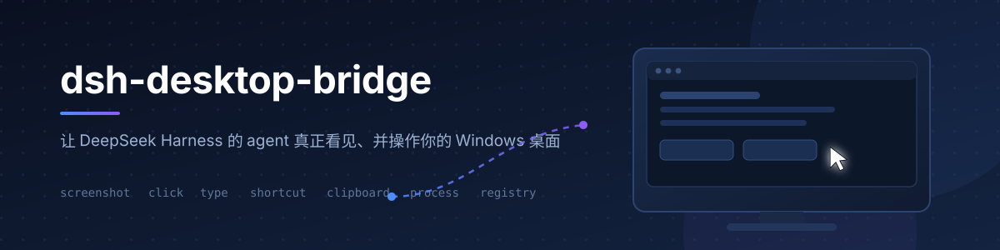
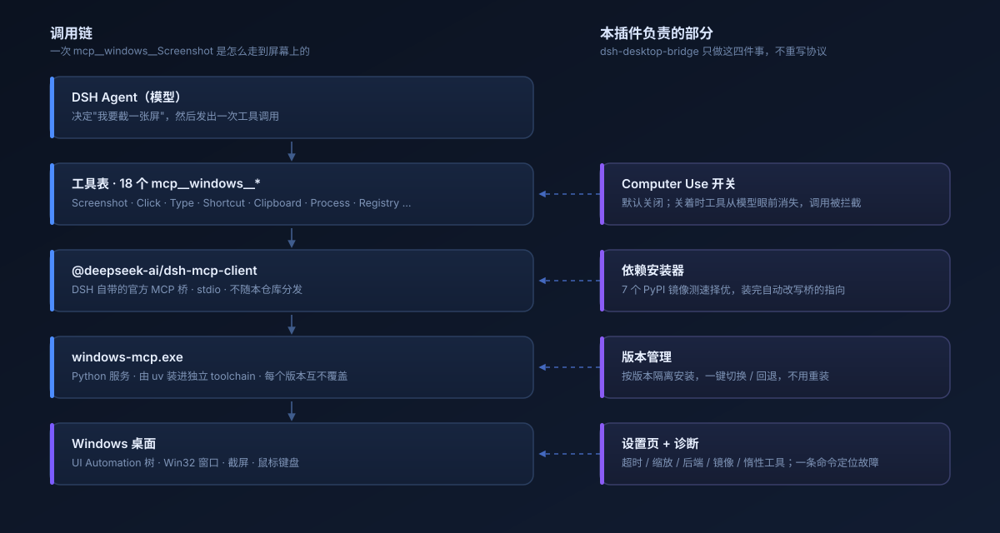
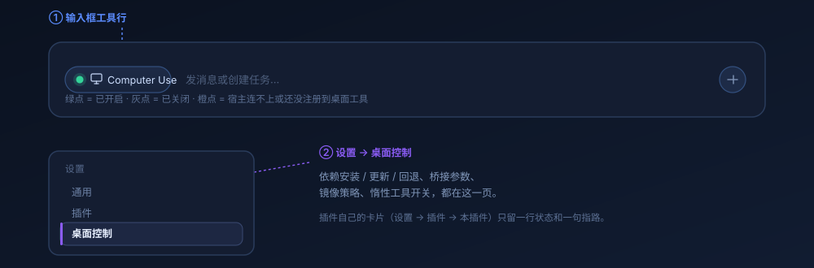
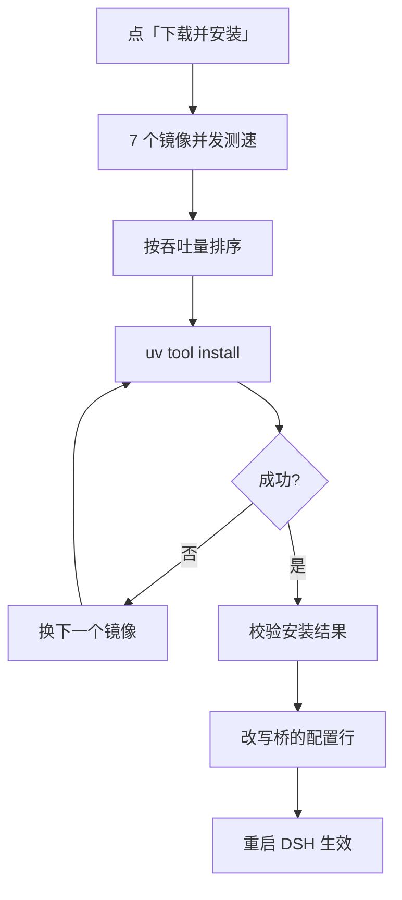
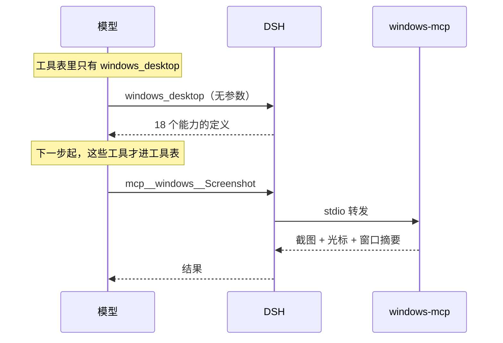

<div align="center">
  
</div>

<h1 align="center">dsh-windows-control</h1>

<p align="center">
  <b>把 Windows 桌面交给 agent，但由你说了算。</b><br>
  截屏 · 点击 · 输入 · 快捷键 · 剪贴板 · 进程 · 注册表 —— 默认关闭，随时一键开启。
</p>

<p align="center">
  <a href="https://github.com/xkzm123/dsh-windows-control/actions/workflows/ci.yml"></a>
  
  
  
</p>

<p align="center">
  <a href="#它能做什么">它能做什么</a> ·
  <a href="#三分钟上手">快速开始</a> ·
  <a href="#配置">配置</a> ·
  <a href="#常见问题">常见问题</a>
</p>

---

## 这是什么

DeepSeek Harness 的 agent 能读文件、跑命令，但它看不见你的屏幕。

**dsh-windows-control** 补上这一段：它把 [CursorTouch/Windows-MCP](https://github.com/CursorTouch/Windows-MCP) 接进 DSH，于是模型可以截一张屏、找到那个按钮、点下去、把结果读回来——真实窗口、真实鼠标、真实键盘。

它不是一个新写的 MCP 客户端。DSH 内部本来就带着官方的 MCP 桥（`@deepseek-ai/dsh-mcp-client`），这个插件只做四件桥做不到的事：**把开关交给人、把依赖装好、把版本管住、把参数摊开**。

> 桌面控制是**默认关闭**的。装完插件、装好依赖，你不点那个开关，模型连工具名都看不见。

---

## 它能做什么

装上之后，工具表里会出现 18 个 `mcp__windows__*` 工具：

| 分类 | 工具 | 干什么 |
| --- | --- | --- |
| **看** | `Screenshot` `Snapshot` | 截屏，附带光标位置、窗口列表、屏幕尺寸 |
| | `DisplayInventory` | 多显示器布局与 DPI |
| | `Scrape` | 抓一个网页的正文 |
| **操作** | `Click` `Move` `Scroll` | 按坐标或按控件名点击、移动、拖拽、滚轮 |
| | `Type` `MultiEdit` | 输入文本、批量填表 |
| | `MultiSelect` | 多选文件 / 复选框 |
| | `Shortcut` | `ctrl+c` 这类组合键 |
| **等** | `Wait` `WaitFor` | 等固定秒数，或等某个 UI 条件成立 |
| **系统** | `Clipboard` | 读写剪贴板 |
| | `Process` | 列进程、结束进程 |
| | `Registry` | 读写注册表 |
| | `Notification` | 弹一个系统通知 |
| | `ControlStatus` | 当前桌面控制归属与用户空闲时长 |

典型用法：

- 「打开设置，把缩放调到 125%」——截屏 → 找到入口 → 点击 → 再截屏确认
- 「把这张表从网页抄进 Excel」——`Scrape` 取数 → `MultiEdit` 批量填
- 「看看是哪个进程占了 CPU」——`Process` 列表 + `Notification` 汇报
- 「帮我把这段文字复制到微信」——`Clipboard` 写入 → 切窗口 → `Shortcut` 粘贴

---

## 为什么不是"又一个 MCP 客户端"

<div align="center">
  
</div>

左边是调用链，一条都不归这个仓库管：模型发调用、官方桥走 stdio、`windows-mcp.exe` 用 UI Automation 和 Win32 干活。

右边四件事才是这个插件存在的理由：

- **开关归人。** 桌面控制的开启/关闭是一条 HTTP 路由，写入 `$DSH_HOME`，重启后仍在。关闭时工具从模型的工具表里消失，硬调用也会被 dispatch guard 拒绝——不是"提示一下"，是拿不到。
- **依赖自己装。** Windows-MCP 是个 Python 程序。插件在 7 个 PyPI 镜像之间测速择优，装完自动把桥指向装好的 exe，**下次开机不再碰网络**。
- **版本互不覆盖。** 每个版本装在 `toolchain/<version>/` 下，切换只是改写一行配置，回退不下载任何东西。
- **参数摊开。** 超时、截图缩放、截图后端、要屏蔽哪些工具、用哪个镜像、要不要惰性工具——都在设置页里，不用手改 YAML。

---

## 为什么叫 `control` 而不是 `mcp`

改名之前它叫 `dsh-windows-mcp`（上游）／`dsh-desktop-bridge`（第一次 fork）。两个名字都在描述"把 Windows-MCP 接进来"这件事——那是它的历史，不是它现在卖的东西。

实测一台 Windows 11 + `windows-mcp` 0.8.8 的机器上，用这个插件去开一个游戏窗口并点进关卡：

| 动作 | 走桥 | 实测 |
| --- | --- | --- |
| 问"桌面上有什么窗口、各自的矩形" | `Snapshot`（UIA 全桌面遍历） | **26.06s**，预热后第二次 **27.24s**，对 SDL/OpenGL 窗口返回 0 个元素 |
| 同样的窗口枚举 | `EnumWindows` + `GetWindowRect` | **2ms** |
| 每次调用前的控制权仲裁 | `ControlStatus` 返回 `USER_CONTROL` | 最多 **10s** 拒绝一切桌面调用 |
| 起进程并等到窗口出现 | 没有原语（`App` 默认被排除，`Process` 只能 list/kill） | 只能靠 shell 轮询 |

所以这个仓库除了接线，还要自己持有一条**原生 Win32 快通道**：窗口几何、启动、注入、取色。名字跟着职责走。

`mcp__windows__*` 那 18 个工具仍然在，一行都没改——`Snapshot` 在真有无障碍元素的窗口（浏览器、原生控件、设置页）上依然值得那 26 秒。快通道只接管它答不好的那部分。

---

## 快通道（WIP）

`lib/fastpath.js` + `tools/fastpath-host.ps1`：一个常驻的 PowerShell JSON-lines 宿主，声明 Per-Monitor V2 DPI，直接调 Win32。

| op | 用途 | 典型耗时 |
| --- | --- | --- |
| `windows` / `rect` | 可见顶层窗口 + 物理像素矩形（与 `Click` 同一坐标系） | 2–30ms |
| `focus` | 激活窗口（含 AttachThreadInput 兜底） | ~120ms |
| `launch` | 起进程 → 等窗口 → 回矩形，一条调用 | 进程启动时间 |
| `click` / `move` / `key` / `type` | SendInput 绝对坐标（虚拟桌面），不经控制闸门 | 40–80ms |
| `pixel` / `wait` | 取色 / 等窗口或等像素，替掉"再截一张图" | 30–80ms |

**状态：尚未接线。** 宿主目前启动即崩（`$stdout.AutoFlush` 在 PowerShell 里不存在），修复后再在 `lib/index.js` 注册 `windows_fast` 工具。在那之前它不参与任何运行路径。

---

## 三分钟上手

### 1. 装 uv（Python 包管理器）

```powershell
winget install --id=astral-sh.uv -e
```

装完**重启 DSH**，让它能在 PATH 上找到 `uv`。

### 2. 装插件

在 **DSH Desktop → 设置 → 插件** 里添加这个 bundle，填仓库地址：

```
github:xkzm123/dsh-windows-control
```

非 Electron 的 profile 也可以用命令行：

```powershell
dsh plugin --profile <profile> add github:xkzm123/dsh-windows-control
```

装完**重启 DSH**，让新的 patch 层在启动时生效。

> `desktop` 这个 profile 归 Electron 应用所有，CLI 会拒绝所有针对它的命令——包括只读的。改 `desktop` 请走图形界面。

### 3. 装依赖 + 开开关

打开 **设置 → 桌面控制 → 依赖**，点 **下载并安装**：

- 首次约 60 MB，走测速最快的镜像，页面上能实时看到安装日志
- 装完插件会自动把桥指向新装的 exe，**再重启一次 DSH** 让它生效
- 重启后回到输入框，点左下角的 **Computer Use**，指示灯变绿

到这里就通了。问模型一句「截个屏看看我现在在干什么」验证一下。

---

## 界面在哪里

<div align="center">
  
</div>

只有两个地方：

- **输入框工具行**：`Computer Use` 胶囊，带一个状态点。绿=开，灰=关，橙=宿主连不上或还没注册到工具。
- **设置 → 桌面控制**：依赖安装 / 更新 / 回退、桥接参数、镜像策略、惰性工具开关，全在这一页。

插件自己的卡片（设置 → 插件 → 本插件）只留一行状态和一句指路，不重复放安装按钮。

---

## 配置

全部在 **设置 → 桌面控制**。改完点保存，插件参数立即生效，**桥接参数要重启 DSH**（MCP 客户端只在启动时读一次那一行配置）。

| 项 | 默认 | 说明 |
| --- | --- | --- |
| 工具调用超时 | `120000` ms | 5000–600000。截屏和 UI 树遍历很慢，调小容易中断，调大卡住时等得久 |
| 截图缩放 | `0.75` | `0.25 / 0.5 / 0.75 / 1`。越小越省视觉 token，细节也越少 |
| 截图后端 | `auto` | `dxcam` 最快，`mss` 居中，`pillow` 最慢但最稳 |
| 截图闪光边框 | 关 | 关掉可少一次桌面重绘 |
| 屏蔽的工具 | `App, PowerShell, FileSystem` | 不出现在工具表里，省上下文 |
| 启动时检查更新 | 开 | 每次启动后台查一次，结果缓存 6 小时 |
| 首选镜像 | `auto` | 也可以固定 USTC / 阿里云 / 腾讯云 / 华为云 / 南京大学 / 清华 TUNA / PyPI |
| 惰性工具 | 开 | 平时只给模型一个入口，调用后才下发工具定义 |

设置写在 `$DSH_HOME/dsh-windows-control.settings.json`，原子写入；越界的值会被夹回默认并明确告诉你，不会静默写坏。

---

## 工作原理

### 装依赖



### 惰性工具（默认开启）



18 份 schema 每一步都占上下文，包括根本没人碰桌面的那些步骤。惰性工具把这一步挪到"真的要用了"的时候，调用后按 session 记住。

---

## 安全模型

三条，按重要性排：

1. **默认关闭，且关闭是真的关闭。** 工具既不出现在工具表，调用也会被 dispatch guard 拦下。开关状态存在 `$DSH_HOME/dsh-windows-control.state.json`，重启不丢。
2. **改开关必须来自 DSH 窗口。** 所有写操作（开关、安装、更新、设置）都要求带 GUI 的签名 session cookie——模型就算有 shell 权限，也没法给自己开桌面控制。拿不到 `connection` 服务的部署会在 `/state` 里报 `gate: unobservable`，不会假装安全。
3. **不回家。** 上游默认开 PostHog 遥测，插件在桥的行里写死 `ANONYMIZED_TELEMETRY=false`。

除此之外请自己判断：一旦开关打开，模型能做你在这个桌面上能做的一切——包括读写注册表、结束进程。不确定的时候，先关掉开关再让它干活。

---

## 常见问题

**装了插件，但模型看不到桌面工具**
桥的那一行出厂是 `disabled: true`，这是故意的：`uvx` 冷启动会解析整棵 Python 依赖树，慢网络下能把 DSH 卡在"加载插件"好几分钟。去 **设置 → 桌面控制 → 依赖** 点安装，装完重启。

**显示「未找到 uv」**
`uv` 不在跑 DSH 那个进程的 PATH 上。装完 uv 要**重启 DSH**，不是重启终端。

**改了桥接参数没反应**
桥接参数写进 profile 的 `cordis.patch.yml`，MCP 客户端只在启动时读一次。**重启 DSH**。设置页会明确显示"已写入，重启后生效"。

**提示「检测到多个已装本插件的 profile」**
插件不去猜该改哪一个。给跑 DSH 的进程设 `DSH_DESKTOP_BRIDGE_PROFILE=<profile 名>`，或给绝对路径，再重试。

**截图太糊 / 太费 token**
调 `截图缩放`：要看清小字用 `1`，只想看布局用 `0.5`。还可以关掉惰性工具以外的东西——比如把 `App`、`PowerShell` 屏蔽掉省上下文。

**工具调用超时**
截屏和 `WaitFor` 本来就慢。把 `工具调用超时` 往上调（最大 600000），比反复重试划算。

**想彻底停用**
关掉 Computer Use 就够了——工具对模型不可见。想连依赖一起清掉：`uv tool uninstall windows-mcp`，再删掉 `$DSH_HOME/dsh-windows-control/toolchain`。

---

## 开发

```powershell
npm install
npm test        # 43 个用例，约 11 秒
npm run check   # 语法检查
npm run dump    # 在真实 profile 上打印合成后的配置树，不改动它
```

零运行时依赖，只用 `node:*`。三条纪律写在 `lib/index.js` 头部，改代码前先读：`apply()` 永不抛、只注入确定存在的服务、不打日志噪音。

调试工具在 `tools/`（不发布到 npm）：`mcp-handshake.mjs` 直接和 Windows-MCP 握手，`probe-asar.mjs` 读 Electron 的 `app.asar`，`update-e2e.mjs` 跑真实的下载→激活→回退链路。

欢迎提 issue 和 PR。

---

## 致谢与许可

MIT，见 [LICENSE](LICENSE)。

- [CursorTouch/Windows-MCP](https://github.com/CursorTouch/Windows-MCP)（MIT）负责真正的桌面自动化，本项目只做接线。
- 本项目派生自 [dsh-windows-mcp](https://github.com/helloHub1212/dsh-windows-mcp)（MIT），原始版权声明保留在 `LICENSE`，详见 [NOTICE](NOTICE)。
- MCP 客户端桥属于 DeepSeek Harness 本体，不在本仓库分发。
- 与 DeepSeek 官方、Windows-MCP 作者均无隶属关系。
