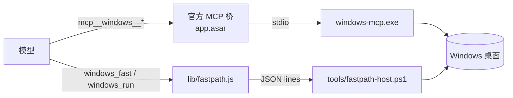
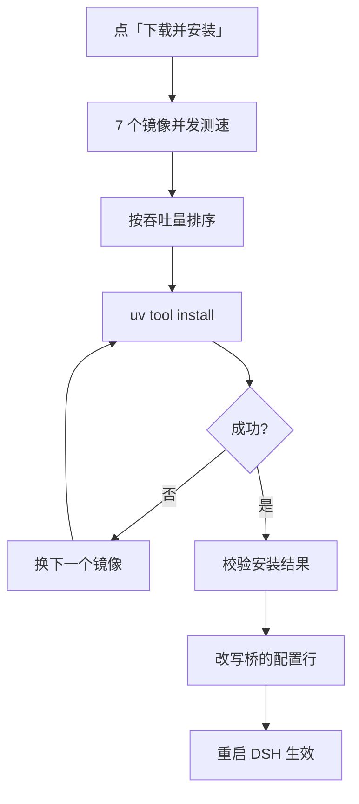

# dsh-windows-control

[](https://github.com/xkzm123/dsh-windows-control/actions/workflows/ci.yml)
[](LICENSE)


给 [DeepSeek Harness](https://github.com/sandbaseai/deepseek-harness-handbook) 的 Windows 桌面控制。

两条通道：**官方 MCP 桥**把 [CursorTouch/Windows-MCP](https://github.com/CursorTouch/Windows-MCP) 的 18 个工具接进来，负责"看见"；**原生 Win32 快通道**自己算窗口几何、起进程、点下去，负责"动手"。

[安装](#安装) · [用法](#用法) · [实测](#实测) · [原理](#原理) · [限制](#限制)

---

## 这是什么

装上之后，模型在工具表里会多出两批东西：

| 批次 | 工具 | 来自 |
| --- | --- | --- |
| 桥接 | `mcp__windows__Screenshot` / `Snapshot` / `Click` / `Type` / `Clipboard` / `Registry` … 共 18 个 | Windows-MCP，经 DSH 自带的 MCP 客户端 |
| 原生 | `windows_fast`、`windows_run` | 本仓库，`lib/fastpath.js` + `tools/fastpath-host.ps1` |

本仓库不实现 MCP 协议，也不打包 MCP SDK。桥是 DSH 本体的一部分（`@deepseek-ai/dsh-mcp-client`，在 `app.asar` 里），这里只负责挂载它、装它的依赖、给它一条更快的旁路。

## 为什么需要第二条通道

拿一个真实窗口试出来的。Windows 11 + `windows-mcp` 0.8.8，用这个插件驱动 Kingdom Rush Origins（LÖVE/SDL + OpenGL，自绘界面，没有任何无障碍节点）：

| 要做的事 | 走桥 | 实测 |
| --- | --- | --- |
| 桌面上有哪些窗口、各自在哪 | `Snapshot`（整桌面 UIA 遍历） | **26.06 s**，预热后第二次 **27.24 s**，对 SDL 窗口返回 0 个元素 |
| 同样这批窗口 | `EnumWindows` + `GetWindowRect` | **2 ms** |
| 起一个进程并等它的窗口 | 没有这个能力（`App` 默认被排除，`Process` 只能 list/kill） | 只能自己写 shell 轮询 |
| 每次调用前的控制权仲裁 | `ControlStatus` | 返回 `USER_CONTROL` 时，**最多 10 s** 拒绝一切桌面调用 |

26 秒是上游的设计选择（全桌面可访问性优先），不是 bug。在 `site-packages` 里打补丁活不过下一次 `uv tool upgrade`，所以这里的做法是**上游一行不改，插件自带旁路**：`Snapshot` 在真有无障碍元素的窗口（浏览器、原生控件、设置页）上依然值得那 26 秒，快通道只接管它答不好的部分。

## 安装

### 1. 装 uv

```powershell
winget install --id=astral-sh.uv -e
```

装完**重启 DSH**，让跑 DSH 的那个进程能在 PATH 上找到 `uv`。

### 2. 装插件

DSH Desktop → **设置 → 插件** → 添加 bundle，填：

```
github:xkzm123/dsh-windows-control
```

非 Electron 的 profile 也可以用命令行：

```powershell
dsh plugin --profile <profile> add github:xkzm123/dsh-windows-control
```

装完**重启 DSH**。

> `desktop` 这个 profile 归 Electron 应用所有，CLI 会拒绝所有针对它的命令，包括只读的。改 `desktop` 走图形界面。

### 3. 装依赖 + 开开关

**设置 → 桌面控制 → 依赖** → **下载并安装**。首次约 60 MB，走测速最快的镜像，页面上能实时看到日志。装完插件会把桥指向新装的 exe，**再重启一次 DSH**。

回到输入框，点左下角的 **Computer Use**，指示灯变绿。问模型一句"截个屏看看我现在在干什么"验证。

## 用法

### `windows_fast`：一次一步

| op | 作用 | 典型耗时 |
| --- | --- | --- |
| `windows` | 可见顶层窗口 + **物理像素**矩形（和 `click` 同一坐标系） | 2–22 ms |
| `rect` / `focus` | 单个窗口的矩形 / 激活它（ALT 轻敲 + topmost + `SwitchToThisWindow`，并验证前台） | 20–280 ms |
| `launch` | 起进程 → 等窗口稳定 → 回矩形 | 1.6–3.0 s |
| `click` / `move` | SendInput 绝对坐标；给 `title`/`hwnd` 会先聚焦，聚焦失败就报错 | 90–340 ms |
| `key` / `type` | `"ctrl+s"`、`"F5"`；Unicode 直输 | 40–90 ms |
| `pixel` | 读一个像素，返回 `#rrggbb` | 5–35 ms |
| `wait` | `mode: window \| window_size \| pixel \| idle` | 80–900 ms |
| `kill` | 按 pid 或 hwnd 结束进程 | 10 ms |

```json
{ "op": "windows", "filter": "Kingdom" }
{ "op": "click", "title": "王国保卫战", "x": 1073, "y": 745 }
{ "op": "pixel", "x": 600, "y": 730 }
```

### `windows_run`：一条 recipe 跑完一串

```json
{
  "steps": [
    { "launch": { "path": "C:\\game.exe", "title": "Game", "timeoutMs": 20000 } },
    { "click_until": { "window": "Game", "at": [303, 473], "relative": true,
                       "until": { "minWidth": 1900, "stableMs": 700 } } },
    { "click_until": { "at": [440, 724], "retries": 3, "timeoutMs": 2500,
                       "until": { "pixel": [600, 730], "hex": "#A8AC97" } } }
  ]
}
```

可用步骤：`launch`、`wait_window`、`focus`、`rect`、`click`、`click_until`、`move`、`key`、`type`、`pixel`、`wait_pixel`、`wait_idle`、`assert`、`sleep`。每一步都会计时并回报，失败时给出行号和当时的实际值。

`click_until` 是这里的核心：点完立刻盯一个条件，没变就重试。条件两种写法——窗口尺寸（`minWidth`/`minHeight`/`stableMs`），或像素（`pixel: [x,y]` 配 `hex` 或 `not`）。游戏启动器会先吞掉一次点击再响应，没有这层验证，后面的点击序列会静默错位。

recipe 可以存成文件反复用：`$DSH_HOME/windows-control/recipes/<name>.json`，然后 `windows_run({ "profile": "kingdom-rush-origins" })`。仓库里的 [`examples/kingdom-rush-origins.json`](examples/kingdom-rush-origins.json) 就是下面那份实测数据用的配方。

## 实测

### 端到端：启动到进战场

同一台机器，1920×1080，同一款游戏：

| 步骤 | op | 耗时 | 尝试 | 判定条件 |
| --- | --- | --- | --- | --- |
| 启动 → 窗口稳定 | `launch` | 2.97 s | 1 | 标题非空 + 矩形连续三次采样不变 |
| 配置窗「开始」 | `click_until` | 6.74 s | 3 | 窗口变成 ≥1900 宽并稳定 700 ms |
| 聚焦游戏窗口 | `focus` | 0.28 s | 1 | `GetForegroundWindow()` 等于目标 hwnd |
| 主菜单「开始」 | `click_until` | 3.47 s | 2 | (600,730) 变成石板色 `#A8AC97` |
| 「存档 1」 | `click_until` | 0.31 s | 1 | (600,730) 离开石板色 |
| 关卡节点 | `click_until` | 4.51 s | 2 | (533,400) 变成羊皮纸色 `#EFD37B` |
| 「战斗」 | `click_until` | 0.75 s | 1 | (533,400) 离开羊皮纸色 |

**合计 19.0 s，一次模型调用。** 同样的路径全走 MCP 桥是 **18 次工具调用、304 s**——其中真正干活的桌面动作只有约 6 s，其余是模型往返（230 s）和可以被省掉的等待（26 s 的 `Snapshot`、两次各约 10 s 的控制权封锁）。

省下来的不是毫秒，是往返次数。这也是 recipe 存在的唯一理由。

## 三个把点击吞掉的坑

都是这轮真机调试撞出来的，注释留在代码里：

**1. `SendInput` 的按下/抬起也必须带坐标。** 只给 `MOUSEEVENTF_MOVE` 归一化坐标、按下抬起传 `(0,0)`，在 `ABSOLUTE` 下会被归一化成虚拟桌面左上角——于是每次点击都落在屏幕角上，而 `GetCursorPos` 仍然老实报告你想要的点。看起来点了，其实没点到。

**2. `Process.MainWindowHandle` 会指向 SDL 的隐藏辅助窗口。** 实测那个窗口 806×629、无标题，真正的启动器窗口是 406×529 并且会在约 1 秒内从前者切过去。所以 `launch` 只认"新出现的、有标题的、矩形连续三次采样不变的"窗口。

**3. `AttachThreadInput` + `SetForegroundWindow` 一 detach 就把前台还回去了。** 表现是聚焦成功后约 500 ms 游戏被 Edge 顶下去，之后每一次点击都打进 Edge。现在改成 ALT 轻敲 + topmost 往返 + `SwitchToThisWindow` 兜底，并且**点之前验证前台真的等于目标窗口，不等就返回错误**，绝不假装成功。

## 原理



桥那条链路一行都不归这个仓库管：模型发调用、官方桥走 stdio、`windows-mcp.exe` 用 UI Automation 和 Win32 干活。快通道是第二个子进程，启动时声明 Per-Monitor V2 DPI，直接调 `user32`/`gdi32`，第一次调用时才会拉起（约 1.5 s），之后每次调用 5–340 ms。

### 惰性工具（默认开启）

18 份 schema 每一步都占上下文，包括根本不碰桌面的那些步骤。开启后工具表里只有一个 `windows_desktop` 入口，调用后才把选中的能力下发，并按 session 记住。关掉这个设置就恢复"每步都全量下发"。

### 装依赖



## 配置

全部在 **设置 → 桌面控制**。改完保存，插件参数立即生效；**桥接参数要重启 DSH**（MCP 客户端只在启动时读一次那一行）。

| 项 | 默认 | 说明 |
| --- | --- | --- |
| 工具调用超时 | `120000` ms | 5000–600000。截屏和 UI 树遍历很慢，调小容易中断 |
| 截图缩放 | `0.75` | `0.25 / 0.5 / 0.75 / 1`。越小越省视觉 token |
| 截图后端 | `auto` | `dxcam` 最快，`mss` 居中，`pillow` 最慢但最稳 |
| 截图闪光边框 | 关 | 关掉可少一次桌面重绘 |
| 屏蔽的工具 | `App, PowerShell, FileSystem` | 不出现在工具表里，省上下文 |
| 启动时检查更新 | 开 | 后台查一次，结果缓存 6 小时 |
| 首选镜像 | `auto` | 也可固定 USTC / 阿里云 / 腾讯云 / 华为云 / 南京大学 / 清华 TUNA / PyPI |
| 惰性工具 | 开 | 平时只给模型一个入口 |

设置写在 `$DSH_HOME/dsh-windows-control.settings.json`，原子写入；越界的值会被夹回默认并明确告诉你。

快通道还有两个环境变量：`DSH_WINDOWS_MCP_PWSH` 指定用哪个 PowerShell（默认 `pwsh.exe` → `pwsh` → `powershell.exe`），`DSH_DESKTOP_BRIDGE_PROFILE` 指定改哪个 profile 的 patch 层。

## 安全模型

1. **默认关闭，且关闭是真的关闭。** 工具既不出现在工具表，调用也会被 dispatch guard 拦下。开关状态存在 `$DSH_HOME/dsh-windows-control.state.json`，重启不丢。
2. **改开关必须来自 DSH 窗口。** 所有写操作（开关、安装、更新、设置）都要求带 GUI 的签名 session cookie——模型就算有 shell 权限，也没法给自己开桌面控制。拿不到 `connection` 服务的部署会在 `/state` 里报 `gate: unobservable`，不会假装安全。
3. **不回家。** 上游默认开 PostHog 遥测，插件在桥的行里写死 `ANONYMIZED_TELEMETRY=false`。

开关一旦打开，模型能做你在这个桌面上能做的一切，包括读写注册表和结束进程。不确定的时候先关掉。

## 限制

- **配方里的坐标绑定分辨率。** `examples/kingdom-rush-origins.json` 是 1920×1080 下量的，换分辨率要重量。模板匹配和 OCR 还没做——那是让配方脱离硬编码坐标的下一步。
- **无障碍信息仍然只有桥能给。** 快通道只做 Win32，不碰 UIA。要读浏览器或原生控件的元素，还是得走 26 秒的 `Snapshot`。
- **快通道是个 PowerShell 子进程。** 首次启动约 1.5 s；每次调用比进程内调用多一次 IPC，但对 5 ms 级的操作来说这部分开销是可见的。
- **上游 18 个工具一行没改。** 它们的慢、它们的 `USER_CONTROL` 闸门，这里都原样保留，只是不再挡在关键路径上。

## 常见问题

**装了插件，但模型看不到桌面工具**
桥的那一行出厂是 `disabled: true`，故意的：`uvx` 冷启动会解析整棵 Python 依赖树，慢网络下能把 DSH 卡在"加载插件"好几分钟。去 **设置 → 桌面控制 → 依赖** 点安装，装完重启。

**显示「未找到 uv」**
`uv` 不在跑 DSH 那个进程的 PATH 上。装完 uv 要**重启 DSH**，不是重启终端。

**改了桥接参数没反应**
桥接参数写进 profile 的 `cordis.patch.yml`，MCP 客户端只在启动时读一次。**重启 DSH**，设置页会显示"已写入，重启后生效"。

**提示「检测到多个已装本插件的 profile」**
插件不去猜该改哪一个。给跑 DSH 的进程设 `DSH_DESKTOP_BRIDGE_PROFILE=<profile 名>`，或给绝对路径，再重试。

**截图太糊 / 太费 token**
调 `截图缩放`：要看清小字用 `1`，只看布局用 `0.5`。

**想彻底停用**
关掉 Computer Use 就够了——工具对模型不可见。想连依赖一起清掉：`uv tool uninstall windows-mcp`，再删掉 `$DSH_HOME/dsh-windows-control/toolchain`。

## 开发

```powershell
npm install
npm test        # 52 个用例，约 10 秒
npm run check   # 语法检查
npm run dump    # 在真实 profile 上打印合成后的配置树，不改动它
```

零运行时依赖，只用 `node:*`。三条纪律写在 `lib/index.js` 头部，改代码前先读：`apply()` 永不抛、只注入确定存在的服务、不打日志噪音。

调试脚本在 `tools/`（不发布到 npm）：`mcp-handshake.mjs` 直接和 Windows-MCP 握手，`probe-asar.mjs` 读 Electron 的 `app.asar`，`update-e2e.mjs` 跑真实的下载→激活→回退链路；`repro/enum-bench.ps1` 量 `EnumWindows` 的成本。

欢迎提 issue 和 PR。

## 许可与来源

MIT，见 [LICENSE](LICENSE)。

- [CursorTouch/Windows-MCP](https://github.com/CursorTouch/Windows-MCP)（MIT）负责真正的桌面自动化，本项目只做接线。
- 本项目派生自 [dsh-windows-mcp](https://github.com/helloHub1212/dsh-windows-mcp)（MIT），改名为 `dsh-windows-control` 后增加了原生快通道；原始版权声明保留在 `LICENSE`，改名链与改动范围见 [NOTICE](NOTICE)。
- MCP 客户端桥属于 DeepSeek Harness 本体，不在本仓库分发。
- 与 DeepSeek 官方、Windows-MCP 作者均无隶属关系。
